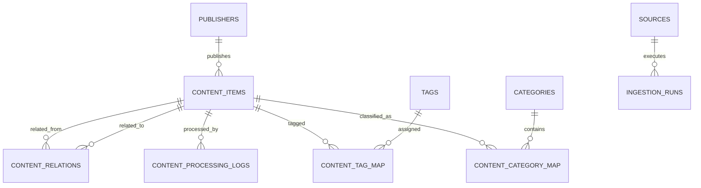

# Database Design — PostgreSQL

## 1. Why PostgreSQL?

The assignment suggests PostgreSQL or SQLite. PostgreSQL is selected because NewsDC has relational entities (publishers, content, categories, tags, ingestion runs) and benefits from foreign keys, indexes, transactions, JSONB and built-in full-text search.

This means the application is React + Node.js + PostgreSQL, not strictly MERN (MongoDB is the M in MERN).

## 2. Entity relationship overview

Local-first user preferences, bookmarks and history are stored in browser local storage for MVP. Optional server-side tables can be used later for anonymous session sync.

## 3. Core entities

### publishers

Stores publisher/channel/platform identity.

- `id`: UUID primary key
- `name`: display name
- `domain`: publisher domain, unique where appropriate
- `homepage_url`: optional URL
- `created_at`, `updated_at`

### sources

Stores configured ingestion endpoints and adapter configuration.

- `id`: UUID
- `name`: source display name
- `source_type`: `RSS`, `API`
- `endpoint_url`: feed/API endpoint
- `is_enabled`: boolean
- `config`: JSONB for non-secret adapter settings
- `last_fetched_at`: timestamp

### content_items

Central unified record for all formats.

- `id`: UUID
- `source_id`: optional source that discovered the item
- `publisher_id`: optional publisher
- `external_id`: source's stable ID, if available
- `content_type`: `ARTICLE`, `VIDEO`, `RESEARCH`, `DISCUSSION`
- `title`, `description`, `url`, `canonical_url`
- `author`, `published_at`
- `thumbnail_url`, `duration_seconds`
- `content_text`: permitted extracted text/transcript/abstract, when available
- `ai_summary`, `key_insights` JSONB
- `intelligence_type`: controlled classification
- `is_data_center_relevant`, `relevance_confidence`
- `relevance_score`, `quality_score`
- `ai_status`: `PENDING`, `PROCESSING`, `COMPLETED`, `FAILED`, `SKIPPED`
- `ai_model`, `prompt_version`, `ai_processed_at`
- `metadata` JSONB for format-specific fields
- `content_fingerprint`
- `search_vector`: generated/search-maintained tsvector
- timestamps

### categories and tags

Categories are controlled taxonomy entries. Tags are extracted or source-provided labels.

### mapping tables

`content_category_map` and `content_tag_map` support many-to-many relationships.

### ingestion_runs

Tracks each source ingestion execution, including counts, status and error summary.

### content_processing_logs

Tracks AI processing attempts and failures for debugging and verification.

### content_relations

Stores related-content edges and their relation score/reason.

## 4. Indexing strategy

- Unique index on `canonical_url` where not null.
- Index on `published_at DESC`.
- Composite index on `(content_type, published_at DESC)`.
- Index on `is_data_center_relevant`, `ai_status`.
- Index on category mapping foreign keys.
- GIN index on `search_vector`.
- Optional GIN index on JSONB metadata only for fields actually queried.

## 5. Data rules

- Preserve original `url`; store normalized `canonical_url` separately.
- Never assume optional source fields exist.
- Store UTC timestamps.
- Keep raw source payload only if needed and permitted; avoid retaining unnecessary personal data.
- Store AI output and provenance (model/prompt version).
- A record with failed AI processing may still appear in a clearly labelled unprocessed/admin view, but should not appear as fully enriched.
- Avoid treating the AI score as objective truth; document it as a heuristic estimate.

## 6. Implemented foundation

`database/migrations/001_foundation.sql` creates the documented tables, constraints, indexes, generated search vector and updated-at triggers. `002_taxonomy.sql` seeds all 14 category slugs matching `packages/shared/src/taxonomy.js`. Categories use their controlled slug as primary key; mapping tables reference that slug.

`packages/db` owns the pool, internal create/read repository and migration runner. `schema_migrations` tracks names/checksums; migrations run transactionally under an advisory lock. Repeated application is a no-op, and changed applied migrations are rejected. Run `npm run db:migrate` after setting root `.env` as described in README.

Verified on PostgreSQL 16: four-format persistence, null optional fields, taxonomy seed, repeated migration, canonical URL uniqueness, range/enum/foreign-key constraints and search-vector updates. This is not an implemented ingestion pipeline or public content/search API. Fingerprint generation, URL normalization and AI processing remain pending.

## AI provider persistence — 6 November 2026

Migrations 004/005 add ai_provider_calls (provider/model/status/timestamps/token usage/safe error code), ai_provider_daily (UTC request counts) and ai_provider_budget (conservative OpenAI usage accounting). User requested removal of spending/fixed daily caps; migration 005 removes the initial upper-bound checks without rewriting applied migration 004. These names are retained for history; they do not enforce an app budget. Accounting is serializable and idempotently finalized through Prisma; no application raw SQL, prompt text or credentials are stored. See AI_PROVIDER_ROUTING.md. Provider connectivity is implemented; content-level AI processing schema fields still await enrichment integration.
