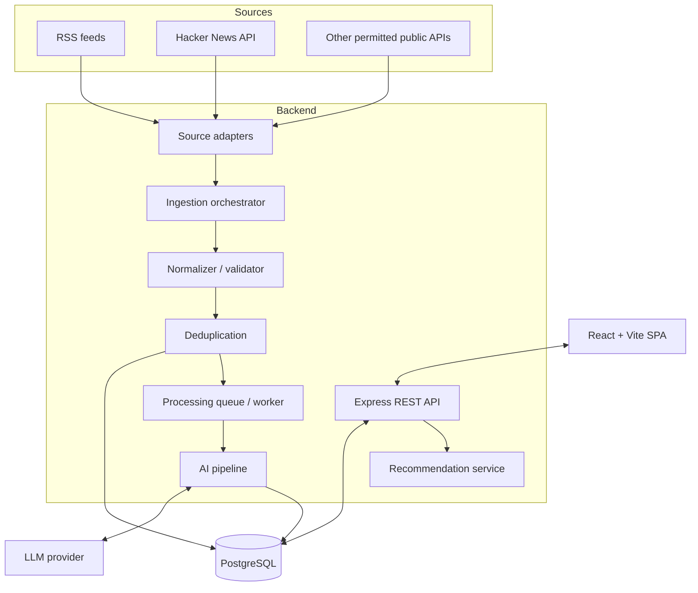

# System Design — NewsDC

## 1. Design goals

- Deliver an end-to-end MVP in 3–4 working days.
- Keep frontend, API, ingestion and AI processing separable.
- Use one unified content model for articles, videos, research and discussions.
- Make ingestion and AI work asynchronous where possible.
- Persist AI outputs so feed reads do not repeatedly call an LLM.
- Make sources, categories and prompts configurable.

## 2. High-level architecture

## 3. Architectural style

Use a **modular monolith** for the assignment. Modules have clear boundaries but can run in one Node.js backend deployment. The ingestion scheduler/worker may be a separate process using the same codebase and database.

Suggested modules:

- `sources`: adapters for RSS and APIs.
- `ingestion`: orchestration, normalization, deduplication and run tracking.
- `content`: content CRUD, details and filters.
- `taxonomy`: categories and tags.
- `ai`: provider client, prompt templates, structured output validation and enrichment pipeline.
- `recommendations`: ForYou, Trending and related ranking.
- `assistant`: retrieval, answer generation and citations.
- `preferences`: user preference payloads (local-first).
- `exports`: JSON and Markdown.
- `admin`: protected operational endpoints and metrics.

## 4. Main data flow

### 4.1 Ingestion flow

1. Scheduler or operator starts a source run.
2. Adapter calls source API/RSS with timeout and rate-limit handling.
3. Adapter maps raw response into a normalized candidate.
4. Validator checks title, URL and source identity.
5. URL canonicalizer removes tracking parameters and normalizes host/path conservatively.
6. Deduplication checks canonical URL and optionally content fingerprint.
7. Insert or update content metadata and create processing status.
8. Enqueue AI enrichment for new/changed records.
9. Record counts and errors in ingestion logs.

### 4.2 AI processing flow

1. Load normalized title, description and permitted text.
2. Detect content type if source does not provide a reliable type.
3. Classify Data Center relevance and confidence.
4. If irrelevant, mark as excluded and stop enrichment.
5. Assign one or more categories.
6. Classify intelligence type: `NEWS`, `TECHNICAL_RESEARCH`, `INVESTMENT_INTELLIGENCE`, `ENGINEERING_IDEA`, or `OTHER`.
7. Generate concise summary and key insights.
8. Calculate/store relevance and quality scores.
9. Validate structured response; retry limited times on invalid output.
10. Store model, prompt version, processing time and status for traceability.

### 4.3 Recommendation flow

For MVP use deterministic ranking rather than training a recommendation model.

Example configurable score:
`rank_score = 0.40 * relevance + 0.25 * quality + 0.20 * freshness + 0.10 * engagement + 0.05 * preference_match`

Normalize every signal to 0–100 first. If engagement is unavailable, redistribute or omit that signal and document the behavior. This is an initial heuristic, not a claim of learned relevance.

- **ForYou:** relevance + quality + freshness + selected topic/content-type preferences; reduce items already read if desired.
- **Trending:** freshness + available engagement + quality/relevance.
- **Topic feed:** topic filter, then ranking.
- **Related:** shared categories/tags first; semantic similarity is future enhancement.

### 4.4 AI assistant / retrieval flow

1. Accept question and optional filters.
2. Search PostgreSQL full-text index over title, description, summary and extracted text.
3. Retrieve top matching records.
4. Build prompt with bounded excerpts and source metadata.
5. Ask LLM to answer only from provided context.
6. Require citation IDs from retrieved records.
7. Validate that cited IDs exist in retrieved set.
8. Return answer, sources and a clear “insufficient evidence” response when context is weak.

For a prototype, PostgreSQL full-text search is sufficient. Embeddings/vector search can be added later if keyword retrieval is inadequate.

## 5. Component responsibilities

| Component              | Responsibility                                            | Must not do                                  |
| ---------------------- | --------------------------------------------------------- | -------------------------------------------- |
| React SPA              | Render views, local preferences and user interactions     | Hold LLM API keys or call LLM directly       |
| Express API            | Validate requests, authorize admin actions, call services | Contain all business logic in route handlers |
| Source adapters        | Fetch and map source-specific data                        | Decide final AI relevance                    |
| Ingestion service      | Normalize, deduplicate and persist records                | Block user feed requests                     |
| AI service             | Enrich text and store structured output                   | Invent unavailable video transcripts         |
| Recommendation service | Rank stored records                                       | Call LLM for every feed item                 |
| Assistant service      | Retrieve context and produce cited answer                 | Answer as if unsupported claims were sourced |
| PostgreSQL             | Persist records, relationships and search data            | Store provider secrets                       |

## 6. Failure handling

- Source timeout: fail that source run, log error, continue other sources.
- Rate limit: back off and retry later; do not hammer source.
- Invalid feed item: quarantine/skip and log reason.
- Duplicate: skip insert or update existing record according to source update policy.
- LLM timeout: mark AI processing failed/retryable; content metadata remains available.
- Invalid LLM JSON: schema validation, one bounded repair/retry, then mark failed.
- Assistant retrieval empty: explain that no supporting content was found.
- Database unavailable: return service error; worker must not mark job complete.

## 7. Security and operational controls

- Keep secrets in server environment variables.
- Validate query parameters and request bodies.
- Limit pagination, payload size and assistant input length.
- Sanitize external text before rendering; React escaping is default, avoid unsafe HTML rendering.
- Treat ingested content as untrusted prompt data, not instructions.
- Protect admin ingestion and metrics endpoints.
- Apply request timeouts and basic rate limits to AI endpoints.
- Log request/job identifiers without logging secrets or unnecessary personal data.

## 8. Scalability path

MVP: modular Express app + PostgreSQL + scheduled worker.

If load grows:

1. Move ingestion/AI jobs to BullMQ + Redis.
2. Run multiple workers with idempotent jobs.
3. Add a dedicated search engine or PostgreSQL vector extension only when measured needs justify it.
4. Separate high-load services only when deployment/ownership/scaling boundaries require it.
5. Add caching for hot feeds and category pages.

## 9. Deployment topology

For MVP, Docker Compose can run:

- `client` static build served by web server.
- `server` Express API.
- `worker` ingestion/AI worker (same image, different command).
- `postgres` database.
- Optional `redis` if BullMQ is enabled.

Use managed PostgreSQL in production if available; persist database storage and back it up.
